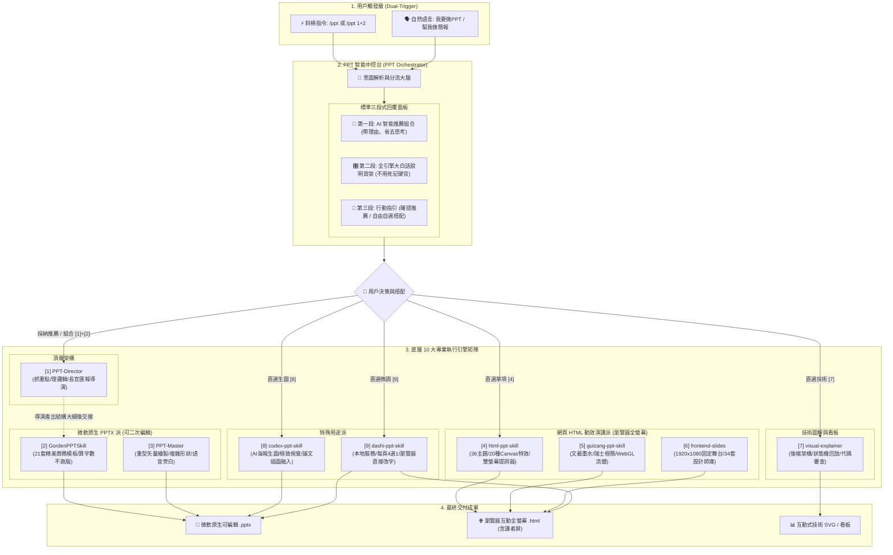

# 🧭 PPT_Skills —— AI 簡報智能中控台與頂級專業引擎矩陣

> **一句話定位**：專為 AI 代理人（Antigravity、Claude Code、Codex、Cursor）打造的簡報全能總控指揮中心。集結開源社區最強大的 10 大 PPT 專案，透過單一指令 `/ppt` 智能分流，兼具**頂層邏輯策劃、微軟原生可編輯 PPTX、網頁全螢幕動態演講、後端技術架構圖解與 AI 論文海報生圖**。

[English](README_en.md) | [繁體中文](README.md)

[](LICENSE)
[](https://github.com/h104651/PTT_Skills)
[]()

---

## 🌟 為什麼需要本專案？

開源社區湧現了許多頂級的 AI PPT 生成工具，但日常使用時常面臨四大痛點：
1. **命名與觸發詞衝突**：所有工具都叫「PPT/Slide」，同時安裝會引發代理人「搶跑」或混亂。
2. **產出格式不合需求**：有時需要能交付客戶二次修改的 `.pptx`，有時需要大會全螢幕帶動效的 `.html`，有時需要架構圖解，傳統單一工具無法兼顧。
3. **記憶成本極高**：每個工具的參數、指令與風格名稱繁雜，用戶記不住。
4. **缺乏頂層思考**：許多工具只會「死板套模板」或「生成大段字」，忽略了受眾畫像與管理價值。

**PPT_Skills** 透過構建 **「智能中控台 (PPT-Orchestrator)」**，將 10 大開源專案收斂為底層引擎。每次喚醒時，自動進行「情境診斷」並展開「大白話全選項貨架」，讓您免記任何指令，自由搭配最頂級的簡報生產流水線！

---

## 🏛️ 系統全景架構圖 (System Architecture)



---

## 🎛️ 如何使用 (Quick Start & Usage)

### 1. 雙觸發機制（怎麼叫出中控台？）

*   **方式 A：斜槓指令（推薦，最順手）**
    ```text
    /ppt
    ```
*   **方式 B：帶素材指令（一步到位，自動診斷推薦）**
    ```text
    /ppt 這是我們團隊 Q3 的系統重構進度，主要是跟技術總監匯報，文檔在下方...
    ```
*   **方式 C：自然語言對話**
    ```text
    「我要做PPT」
    「幫我做一份給主管看的年終總結簡報」
    ```

---

### 2. 中控台的標準三段式回應體驗

每當觸發時，AI 永遠**依序呈現**以下三大部分：

```markdown
#### 🎯 【第一部分：我的客製化建議】
根據您的主題與受眾，推薦最優路線：
* 推薦組合：[1] PPT-Director (導演提煉) ➔ [2] GordenPPTSkill (商務模板)
* 推薦原因：向長官匯報需重視「管理價值與結論」，且需要微軟原生 .pptx 格式。

---

#### 🎛️ 【第二部分：全部選項清單與大白話說明】（不用死記，隨時查看）
[1] PPT-Director    👉 簡報總策劃，專門抓重點理邏輯，濃縮成核心結論與圖解骨架。
[2] GordenPPTSkill  👉 內建 21 套精美商務模板，算好字數無損套版，版面絕不崩潰。
[3] PPT-Master      👉 重型矢量繪圖引擎，支援微軟原生形狀、複雜圖表與語音旁白。
[4] html-ppt-skill  👉 大會演講旗艦，36 主題 + 20 種 Canvas 動效，按 S 鍵開啟雙屏提詞器。
[5] guizang-ppt     👉 歸藏極致美學，WebGL 油墨流體背景，文藝雜誌與瑞士極簡風。
[6] frontend-slides 👉 1920x1080 固定畫布等比縮放，自帶 34 套設計師 HTML 模板。
[7] visual-explainer👉 後端架構圖解器，把複雜邏輯畫成能動態單步回放的流程圖。
[8] codex-ppt-skill 👉 AI 整頁海報生圖派，視覺衝擊力極強，論文插圖無縫融合。
[9] dashi-ppt-skill 👉 本地所見即所得，每頁 4 種版面選 1 種，瀏覽器直接改字保存。

---

#### 🚀 【第三部分：您的選擇】
回覆「OK」採用推薦；或回覆編號自由挑選（例如 [4] 或 [1]+[2]）即可開工！
```

---

## 📦 整合專案矩陣與技術清單 (Project Inventory)

本倉庫整合併收斂了以下優秀開源專案（位於 `.agents/skills/`）：

| 編號 | 專案目錄 | 原開源專案名稱 | 原始作者 | 核心技術棧 | 產出成果 | 核心定位與特色 |
|---|---|---|---|---|---|---|
| **Hub** | `ppt-orchestrator` | PPT 智能中控台 | 本專案維護 | YAML / Markdown / Agent Protocol | 調度決策 | 全域意圖攔截、診斷問診、全選項大白話貨架與流水線分流 |
| **`[1]`** | `ppt-director` | [ppt-director](https://github.com/Hermess/ppt-director) | Hermess | 認知蒸餾 / 設計語言映射 | 結構導演稿 | 頂層政企/高層匯報邏輯策劃，管理價值提煉與主視覺規劃 |
| **`[2]`** | `gorden-ppt` | [GordenPPTSkill](https://github.com/GordenSun/GordenPPTSkill) | Gorden Sun | `python-pptx` / 文本框容量測算 | 原生 `.pptx` | 21 套手打中文商務模板，嚴格算字數無損注入，排版零出錯 |
| **`[3]`** | `ppt-master` | [ppt-master](https://github.com/hugohe3/ppt-master) | Hugo He | DrawingML / SVG 編譯 / TTS | 原生 `.pptx` / MP4 | 工業級原生 PPTX 自由繪製引擎，Office 187 種形狀與語音視頻 |
| **`[4]`** | `html-ppt` | [html-ppt-skill](https://github.com/lewislulu/html-ppt-skill) | Lewis Lulu | CSS Token / 20+ Canvas FX | 獨立 `.html` | 36 主題、20 種 Canvas 特效、按 `S` 開啟 4 磁吸卡片雙屏講者視窗 |
| **`[5]`** | `guizang-ppt` | [guizang-ppt-skill](https://github.com/op7418/guizang-ppt-skill) | 歸藏 (op7418) | WebGL Shader / Motion One | 獨立 `.html` | 文藝墨水與瑞士極簡雙美學，流體背景，橫向翻頁雜誌風 |
| **`[6]`** | `frontend-slides` | [frontend-slides](https://github.com/zarazhangrui/frontend-slides) | Zara Zhang | 16:9 Scale Stage / Bold Pack | 獨立 `.html` | 反 AI 塑料審美，固定比例畫布縮放，行動端與大屏不走樣 |
| **`庫`** | `beautiful-html-templates` | [beautiful-html-templates](https://github.com/zarazhangrui/beautiful-html-templates) | Zara Zhang | 34 套 HTML 模板 / `deck-stage.js` | 模板庫 | 提供日系卡帶、別針便簽、暗夜網格等極具品味的設計師資產 |
| **`[7]`** | `visual-explainer` | [visual-explainer](https://github.com/nicobailon/visual-explainer) | Nico Bailon | Web Components / SVG Stepper | 互動式 `.html` | 後端架構、數據流、Git Diff 審查，隊列/狀態機單步動畫回放 |
| **`[8]`** | `codex-ppt` | [codex-ppt-skill](https://github.com/ningzimu/codex-ppt-skill) | 寧子木 | GPT-Image-2 / AtlasCloud | 圖片背景 `.pptx` | 純 AI 圖像生成派，16:9 整頁高清海報，論文插圖無縫融合 |
| **`[9]`** | `dashi-ppt` | [dashi-ppt-skill](https://github.com/chuspeeism/dashi-ppt-skill) | 大師 PPT 團隊 | Node.js 本地服務 / Vue / React | `.html` / `.pptx` | 本地運行時，每頁 4 套候選方案對比，瀏覽器點選修改並雙向保存 |

---

## 🎯 最佳使用場景推薦矩陣

| 您面臨的真實場景 | 推薦採用的黃金組合 | 為什麼這樣搭配？ |
|---|---|---|
| **向政府長官 / 集團高層匯報** | **`[1] 導演` $\rightarrow$ `[2] Gorden 模板`** | 先由導演把複雜文檔濃縮成「長官看得懂的核心結論與管理價值」，再套入政務/大廠商務模板，版面嚴謹不跑版。 |
| **產品年度發布會 / Demo Day** | **`[4] html-ppt` 或 `[5] 歸藏美學`** | 投影幕呈現 WebGL 或粒子動效；自己的筆電開啟雙屏演講者視窗看著碼錶與逐字稿，舞台張力拉滿。 |
| **後端架構評審 / 重構方案論證** | **`[7] visual-explainer`** | 拒絕枯燥文字，直接產出可互動步進的動態 SVG 狀態回放圖，一目了然看清每一條消息的流轉與邊界情況。 |
| **AI 前沿論文解讀 / 概念路演** | **`[8] codex-ppt-skill`** | 將原論文的架構圖或曲線無縫融入周邊環境，產出海報級質感的整頁幻燈片。 |
| **敏捷產品團隊需要邊看邊調** | **`[9] dashi-ppt-skill`** | 在本機啟動服務，每頁給出 4 種版面選一種，直接在瀏覽器點擊文字微調後匯出 PPTX。 |

---

## 🙏 致謝與開源原創聲明 (Acknowledgements & Credits)

本專案的誕生，完全建立在開源社區各位先行者與頂級設計師的卓越貢獻之上。我們在此向以下原創作者表達最崇高的敬意與感謝：

*   **感謝 [Hugo He](https://github.com/hugohe3)** 開發的 [`ppt-master`](https://github.com/hugohe3/ppt-master)，將 DrawingML 矢量轉譯與 Office 原生形狀發揮到了極致。
*   **感謝 [Zara Zhang](https://github.com/zarazhangrui)** 開發的 [`frontend-slides`](https://github.com/zarazhangrui/frontend-slides) 與 [`beautiful-html-templates`](https://github.com/zarazhangrui/beautiful-html-templates)，樹立了反「AI 廉價塑料感」的高級前端審美標竿。
*   **感謝 [歸藏 (op7418)](https://github.com/op7418)** 開發的 [`guizang-ppt-skill`](https://github.com/op7418/guizang-ppt-skill)，將 WebGL 流體動態美學與雜誌級排版優雅地融入演講現場。
*   **感謝 [Nico Bailon](https://github.com/nicobailon)** 開發的 [`visual-explainer`](https://github.com/nicobailon/visual-explainer)，徹底終結了終端 ASCII 字符畫，為工程師帶來了革命性的動態狀態回放圖解。
*   **感謝 [Lewis Lulu](https://github.com/lewislulu)** 開發的 [`html-ppt-skill`](https://github.com/lewislulu/html-ppt-skill)，打造了功能最完備的 HTML 簡報工作室與 4 磁吸卡片雙屏提詞系統。
*   **感謝 [chuspeeism (大師 PPT 團隊)](https://github.com/chuspeeism)** 開發的 [`dashi-ppt-skill`](https://github.com/chuspeeism/dashi-ppt-skill)，實現了敏捷友好的每頁多版本對比與瀏覽器雙向所見即所得編輯。
*   **感謝 [寧子木](https://github.com/ningzimu)** 開發的 [`codex-ppt-skill`](https://github.com/ningzimu/codex-ppt-skill)，開創了利用多模態生圖模型生成海報級 PPT 與論文插圖融合的全新流派。
*   **感謝 [Gorden Sun](https://github.com/GordenSun)** 開發的 [`GordenPPTSkill`](https://github.com/GordenSun/GordenPPTSkill)，以極致克制的「非破壞性插槽替換」技術，完美解決了中文職場 PPT 排版容易崩潰的痛點。
*   **感謝 [Hermess](https://github.com/Hermess)** 開發的 [`ppt-director`](https://github.com/Hermess/ppt-director)，將簡報帶入了「認知蒸餾、導演規劃、管理價值」的思維深度。

所有收錄模組的版權歸原作者所有，本專案僅提供統一的中控調度、分流路由協議與多工具串聯工作流。

---

## 📄 授權協議 (License)

本專案遵循 MIT 授權協議，各子模組均保留原作者之版權與開源授權聲明。
