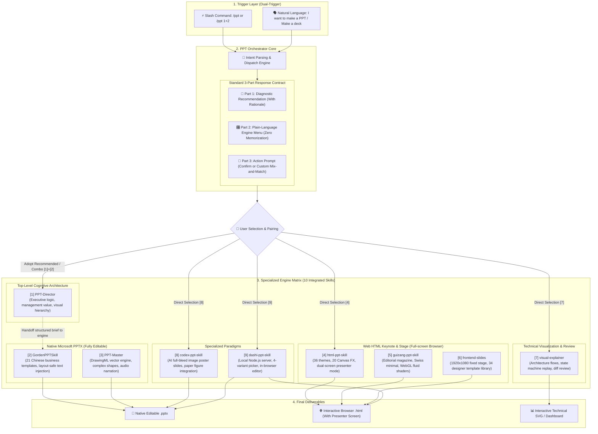

# 🧭 PPT_Skills —— AI Presentation Orchestrator & Elite Engine Matrix

> **One-line Summary**: The unified presentation master command center tailored for coding agents (Antigravity, Claude Code, Codex, Cursor). Harmonizes 10 top-tier open-source presentation projects into a single `/ppt` command, orchestrating **cognitive distillation, native editable PowerPoint (.pptx), full-screen interactive HTML decks with speaker view, technical SVG architecture diagrams, and AI-generated paper poster slides**.

[English](README_en.md) | [繁體中文](README.md)

[](LICENSE)
[](https://github.com/h104651/PTT_Skills)
[]()

---

## 🌟 Why PPT_Skills?

The open-source community has developed remarkable AI presentation tools. However, using them in daily workflows presents four critical challenges:
1. **Trigger & Namespace Clashes**: Every tool competes for the same keywords ("PPT", "slides", "presentation"), causing agents to clash or act unpredictably.
2. **Deliverable Divergence**: Different scenarios demand fundamentally different formats—clients need native `.pptx` for secondary editing, keynotes require interactive full-screen `.html` with animations, and engineers need architecture diagrams. No single tool satisfies all.
3. **High Cognitive Overload**: Memorizing unique parameters, prompt styles, and naming conventions across 10 different repositories is impractical.
4. **Lack of High-Level Thinking**: Many tools jump straight to filling text into templates without understanding audience personas or management value.

**PPT_Skills** introduces a central **PPT-Orchestrator** that unifies all 10 specialized projects as private underlying engines. Every time you invoke it, the orchestrator automatically performs contextual diagnosis and displays a plain-language menu of all options—eliminating memorization while providing complete creative control!

---

## 🏛️ System Architecture



---

## 🎛️ How to Use (Quick Start)

### 1. Dual-Trigger Mechanism

*   **Method A: Slash Command (Fastest & Unambiguous)**
    ```text
    /ppt
    ```
*   **Method B: Command with Topic / Document (Instant Diagnosis)**
    ```text
    /ppt Here is our Q3 microservice refactoring report for the CTO, doc attached below...
    ```
*   **Method C: Natural Language Dialogue**
    ```text
    "I want to make a presentation."
    "Help me create a slide deck for our executive review."
    ```

---

### 2. Standard 3-Part Response Experience

Whenever invoked, the AI **always adheres** to this structured interaction pattern:

```markdown
#### 🎯 [Part 1: Personalized Recommendation]
Based on your topic and audience:
* Recommended Combination: [1] PPT-Director (Distillation) ➔ [2] GordenPPTSkill (Business Template)
* Rationale: Executive reviews prioritize clear management conclusions and require native Microsoft .pptx format.

---

#### 🎛️ [Part 2: Full Engine Menu with Plain Explanations] (Zero Memorization Needed)
[1] PPT-Director    👉 The master director. Distills messy text into 40-word core conclusions and visual bones.
[2] GordenPPTSkill  👉 Business template master. 21 hand-polished templates with non-destructive text injection.
[3] PPT-Master      👉 Heavyweight DrawingML vector engine. Complete shape control, charts, and TTS audio narration.
[4] html-ppt-skill  👉 Keynote studio flagship. 36 themes, 20 Canvas FX, and an 'S' key dual-window presenter view.
[5] guizang-ppt     👉 Editorial aesthetic. WebGL fluid ink backgrounds, Monocle magazine and Swiss grid styles.
[6] frontend-slides 👉 1920x1080 fixed stage with 34 designer templates. Zero layout shifts across displays.
[7] visual-explainer👉 Tech explainer. Interactive SVG diagrams with step-by-step state machine replay.
[8] codex-ppt-skill 👉 Full-bleed AI poster slides. Maximum visual impact with native paper figure integration.
[9] dashi-ppt-skill 👉 Local WYSIWYG editor. Compare 4 variants per slide and edit text directly in your browser.

---

#### 🚀 [Part 3: Action Prompt]
Reply "OK" to proceed with the recommendation, or reply with your preferred combo (e.g., [4] or [1]+[2]) to begin!
```

---

## 📦 Project Inventory & Technical Specs

All skills are housed under `.agents/skills/`:

| ID | Directory | Original Project | Author | Primary Tech Stack | Deliverable | Highlights & Superpowers |
|---|---|---|---|---|---|---|
| **Hub** | `ppt-orchestrator` | PPT Orchestrator | This Repo | YAML / Agent Protocol | Orchestration | Global intent interception, diagnostic triage, plain-language catalog |
| **`[1]`** | `ppt-director` | [ppt-director](https://github.com/Hermess/ppt-director) | Hermess | Cognitive Distillation / Style Mapping | Director Brief | Executive/government reporting director; visual ratio $\ge 55\%$ |
| **`[2]`** | `gorden-ppt` | [GordenPPTSkill](https://github.com/GordenSun/GordenPPTSkill) | Gorden Sun | `python-pptx` / Slot Capacity Math | Native `.pptx` | 21 hand-polished Chinese templates, non-destructive text injection |
| **`[3]`** | `ppt-master` | [ppt-master](https://github.com/hugohe3/ppt-master) | Hugo He | DrawingML / SVG Compiler / TTS | Native `.pptx` / MP4 | Industrial DrawingML compiler, 187 Office shape presets, audio voiceover |
| **`[4]`** | `html-ppt` | [html-ppt-skill](https://github.com/lewislulu/html-ppt-skill) | Lewis Lulu | CSS Design Tokens / 20+ Canvas FX | Standalone `.html` | 36 themes, 20 Canvas FX, 4-card magnetic dual-screen presenter view (`S` key) |
| **`[5]`** | `guizang-ppt` | [guizang-ppt-skill](https://github.com/op7418/guizang-ppt-skill) | 歸藏 (op7418) | WebGL Shaders / Motion One | Standalone `.html` | Editorial Magazine & Swiss International styles with WebGL dynamic ink |
| **`[6]`** | `frontend-slides` | [frontend-slides](https://github.com/zarazhangrui/frontend-slides) | Zara Zhang | 16:9 Scaled Stage / Bold Pack | Standalone `.html` | Anti-AI slop typography, uniform canvas scaling across all screens |
| **`Lib`**| `beautiful-html-templates` | [beautiful-html-templates](https://github.com/zarazhangrui/beautiful-html-templates) | Zara Zhang | 34 HTML Templates / `deck-stage.js` | Template Assets | Curated artistic templates (Pin & Paper, Sakura Chroma, Cobalt Grid) |
| **`[7]`** | `visual-explainer` | [visual-explainer](https://github.com/nicobailon/visual-explainer) | Nico Bailon | Web Components / SVG Stepper | Interactive `.html` | Eliminates ASCII art; dynamic event-by-event queue and state machine replay |
| **`[8]`** | `codex-ppt` | [codex-ppt-skill](https://github.com/ningzimu/codex-ppt-skill) | 寧子木 | GPT-Image-2 / AtlasCloud | Image `.pptx` + Script | Image-based 16:9 slide generation; seamlessly incorporates research figures |
| **`[9]`** | `dashi-ppt` | [dashi-ppt-skill](https://github.com/chuspeeism/dashi-ppt-skill) | Dashi PPT Team | Local Node.js / Vue / React | `.html` / `.pptx` / `.pdf`| Local server with 4 variants per slide and bidirectional browser editing |

---

## 🎯 Best Scenarios & Pipeline Combinations

| Your Scenario | Recommended Pipeline | Why This Pairing? |
|---|---|---|
| **Executive / Board / Government Briefing** | **`[1] Director` $\rightarrow$ `[2] Gorden Template`** | The Director strips filler and establishes management conclusions; Gorden injects the text into strict enterprise templates with zero layout breakage. |
| **Product Keynote / Demo Day / Public Talk** | **`[4] html-ppt` or `[5] guizang-ppt`** | The audience enjoys WebGL or Canvas dynamic visuals; you control the stage using the dual-screen presenter view with live timer and speaker script. |
| **Technical Architecture / System Refactor Review** | **`[7] visual-explainer`** | Replaces wall-of-text explanations with interactive SVG state machines that replay events step-by-step. |
| **AI Paper Reading / High-Concept Pitch** | **`[8] codex-ppt-skill`** | Integrates real architecture diagrams and experimental curves into full-bleed AI poster slides. |
| **Agile Teams Needing Collaborative Visual Tweaks** | **`[9] dashi-ppt-skill`** | Spins up a local server, provides 4 layout options per slide, and lets you edit copy directly in the browser before exporting to PPTX. |

---

## 🙏 Acknowledgements & Open-Source Credits

This repository stands on the shoulders of giants in the AI and open-source presentation communities. We extend our deepest gratitude to the following original authors:

*   **[Hugo He](https://github.com/hugohe3)** for [`ppt-master`](https://github.com/hugohe3/ppt-master) — pushing native DrawingML compilation and Office shape geometry to industrial heights.
*   **[Zara Zhang](https://github.com/zarazhangrui)** for [`frontend-slides`](https://github.com/zarazhangrui/frontend-slides) & [`beautiful-html-templates`](https://github.com/zarazhangrui/beautiful-html-templates) — defining modern, anti-"AI slop" frontend aesthetics.
*   **[歸藏 (op7418)](https://github.com/op7418)** for [`guizang-ppt-skill`](https://github.com/op7418/guizang-ppt-skill) — fusing WebGL fluid dynamics with editorial magazine aesthetics.
*   **[Nico Bailon](https://github.com/nicobailon)** for [`visual-explainer`](https://github.com/nicobailon/visual-explainer) — revolutionizing technical reviews with interactive SVG stepper replays.
*   **[Lewis Lulu](https://github.com/lewislulu)** for [`html-ppt-skill`](https://github.com/lewislulu/html-ppt-skill) — building a powerhouse HTML presentation studio with magnetic dual-window speaker tools.
*   **[chuspeeism (Dashi PPT Team)](https://github.com/chuspeeism)** for [`dashi-ppt-skill`](https://github.com/chuspeeism/dashi-ppt-skill) — pioneering multi-variant candidate comparison and bidirectional in-browser editing.
*   **[寧子木](https://github.com/ningzimu)** for [`codex-ppt-skill`](https://github.com/ningzimu/codex-ppt-skill) — blazing the trail for multimodal AI image-based presentation generation.
*   **[Gorden Sun](https://github.com/GordenSun)** for [`GordenPPTSkill`](https://github.com/GordenSun/GordenPPTSkill) — solving presentation layout fragility through rigorous capacity calculation and non-destructive injection.
*   **[Hermess](https://github.com/Hermess)** for [`ppt-director`](https://github.com/Hermess/ppt-director) — introducing cognitive distillation and management value discipline into AI presentations.

All component copyrights belong to their respective original authors. This project provides unified orchestration, routing protocols, and multi-skill execution pipelines.

---

## 📄 License

Licensed under the [MIT License](LICENSE). Embedded sub-skills retain their original licenses and attribution files.
